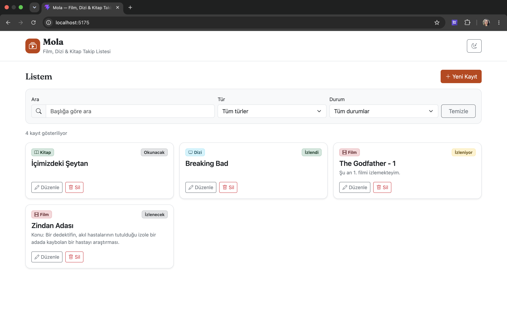
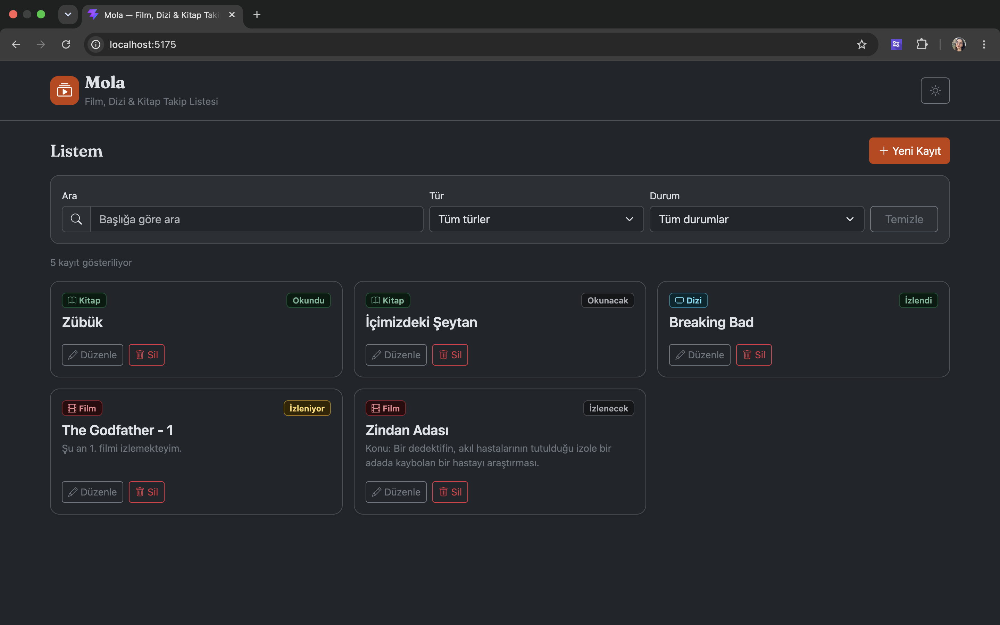
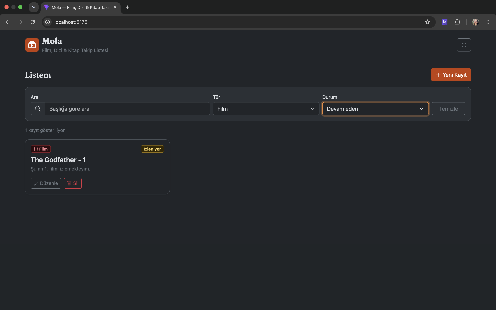
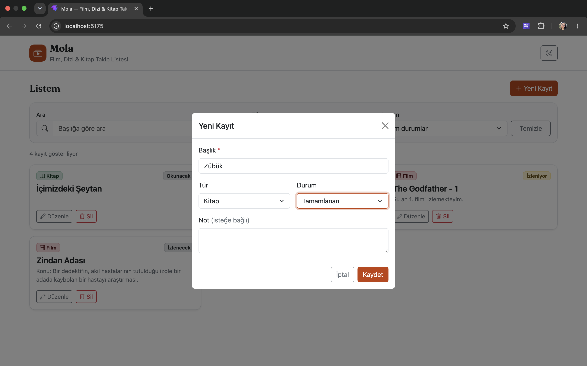

# Mola

Film, dizi ve kitapları tek bir listede takip etmeyi sağlayan tek sayfalık bir web uygulaması. Her kayıt için bir durum tutulur: **planlandı**, **devam ediyor** veya **tamamlandı**. Arayüz tamamen Türkçedir.

## Temel Özellikler

- **Ekleme / listeleme / düzenleme / silme** (CRUD)
- Silmeden önce **onay penceresi**
- Başlık doğrulaması: boş veya yalnızca noktalama/tireden oluşan başlıklar kabul edilmez (en az bir harf veya rakam gerekir)
- **Başlığa göre arama** (büyük/küçük harf duyarsız, Türkçe karakter uyumlu)
- **Tür filtresi** (film / dizi / kitap) ve **durum filtresi** (planlanan / devam eden / tamamlanan)
- Arama ve filtrelerin **birlikte** çalışması; eşleşen kayıt sayısının gösterilmesi
- "Henüz kayıt yok" ve "eşleşen kayıt bulunamadı" için **ayrı** boş durum mesajları
- **Açık / koyu tema** (Bootstrap 5.3 `data-bs-theme`); tercih kalıcı
- Veriler **LocalStorage**'da saklanır; sayfa yenilense de korunur
- Mobil ve masaüstü uyumlu, temel klavye ve erişilebilirlik desteği

## Kullanılan Teknolojiler

- **React** (fonksiyonel bileşenler ve hook'lar)
- **Vite** (geliştirme ve derleme)
- **JavaScript** 
- **Bootstrap 5.3** + **Bootstrap Icons**
- Veri saklama: tarayıcı **LocalStorage**

## Klasör Yapısı

```
mola/
├── docs/                # ekran görüntüleri
├── public/              # statik dosyalar (favicon)
├── src/
│   ├── Components/       # Header, ThemeToggle, WatchItemCard, WatchItemForm, FilterBar, ConfirmDialog
│   ├── Pages/           # HomePage (tek sayfa; ekleme/düzenleme modal ile)
│   ├── Interfaces/      # WatchItem.js (JSDoc ile veri yapısı)
│   ├── hooks/           # useWatchlist.js (CRUD), useTheme.js (tema)
│   ├── utils/           # storage.js (LocalStorage), labels.js (etiket/rozet eşleştirmeleri)
│   ├── App.jsx          # kök bileşen; temayı yönetir
│   ├── main.jsx         # giriş noktası; Bootstrap import'ları
│   └── index.css        # küçük özel stiller
├── index.html
├── package.json
└── vite.config.js
```

Sorumluluk dağılımı:

- LocalStorage okuma/yazma **yalnızca** `src/utils/storage.js` içinde yapılır.
- Ekleme / güncelleme / silme mantığı **yalnızca** `src/hooks/useWatchlist.js` içinde yaşar; bileşenler veriye doğrudan dokunmaz.

## Kurulum

Gereksinim: [Node.js](https://nodejs.org/) (18 veya üzeri önerilir).

```bash
# bağımlılıkları yükle
npm install
```

## Çalıştırma

```bash
# geliştirme sunucusu (varsayılan: http://localhost:5173)
npm run dev

# yayın paketi oluştur (çıktı: dist/ klasörü)
npm run build

# üretim derlemesini yerelde önizle
npm run preview

# kod kontrolü (ESLint)
npm run lint
```

## Veriler Nasıl Saklanır?

Uygulama bir backend kullanmaz. Tüm kayıtlar tek bir dizi olarak tarayıcının **LocalStorage**'ında JSON biçiminde, `mola` anahtarı altında saklanır. Her kayıt şu alanları içerir: `id`, `title`, `type`, `status`, `note`, `createdAt`.

Tema tercihi ayrı bir anahtarda (`mola-theme`) tutulur; bu, kayıt verisini etkilemez.

Veriler yalnızca o tarayıcıda ve o cihazda tutulduğu için tarayıcı verileri temizlendiğinde kayıtlar da silinir.

## Ekran Görüntüleri

### Ana ekran — açık tema


### Ana ekran — koyu tema


### Arama ve filtreleme


### Yeni kayıt ekleme

